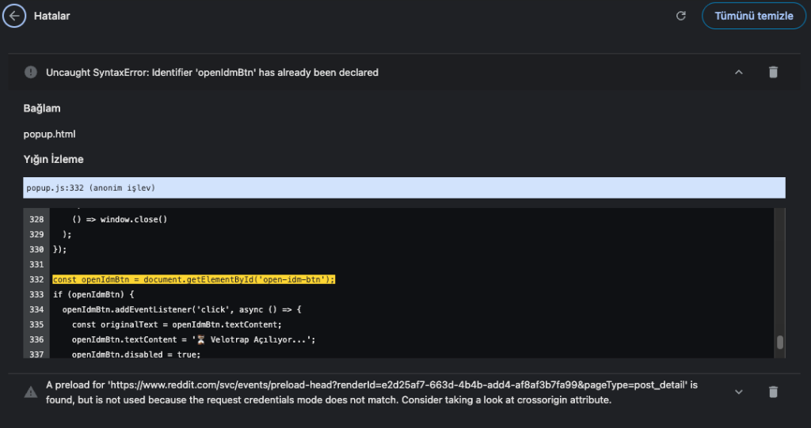
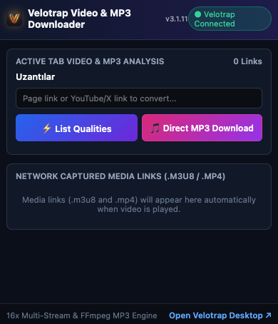
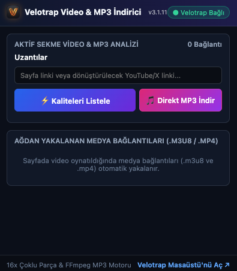
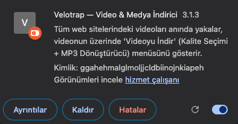

<div align="center">

  

  # ⚡ Velotrap

  **Next-Generation Multi-Threaded Download Accelerator & Universal Media Grabber**

  [](https://github.com/velotrap/velotrap/releases)
  [](https://opensource.org/licenses/MIT)
  [](https://github.com/velotrap/velotrap)
  [](https://www.electronjs.org/)
  [](https://react.dev/)
  [](https://www.typescriptlang.org/)

  <p align="center">
    <a href="#key-features">Key Features</a> •
    <a href="#quick-start">Quick Start</a> •
    <a href="#browser-extension-setup">Browser Extension</a> •
    <a href="#screenshots">Screenshots</a> •
    <a href="#architecture">Architecture</a> •
    <a href="#building-from-source">Build from Source</a> •
    <a href="README.tr.md">Türkçe Dokümantasyon 🇹🇷</a>
  </p>

</div>

---

## 🚀 Overview

**Velotrap** is a modern, high-performance, open-source download manager engineered to replace legacy proprietary download accelerators like Internet Download Manager (IDM).

Built with **Electron**, **TypeScript**, and **React**, Velotrap splits downloads into up to **16 simultaneous parallel connections**, maximizing your network bandwidth. With its seamless **Chrome Companion Extension (Manifest V3)**, Velotrap automatically detects video streams (`.m3u8`, `.mp4`, `.webm`, `.ts`) on any webpage and provides an instant 1-click download widget and studio-grade 320kbps MP3 audio converter.

---

## ✨ Key Features

| Feature | Description |
| :--- | :--- |
| ⚡ **16x Multi-Thread Acceleration** | Slices files into dynamic contiguous byte ranges and downloads them in parallel over independent TCP sockets. |
| 🎬 **Universal Video Sniffer** | Captures HLS (`.m3u8`) playlists and segmented video streams directly from web players in real-time. |
| 🎵 **1-Click 320kbps MP3 Converter** | Seamlessly converts video streams into pristine 320 kbps MP3, 256 kbps M4A, or lossless WAV audio with FFmpeg. |
| 🧩 **Manifest V3 Chrome Extension** | Sleek video overlay widget and popup menu with real-time stream counter and quality selector. |
| 🌐 **Bilingual (English & Turkish)** | Native internationalization (`en` and `tr`) that synchronizes live between desktop and browser extension. |
| 🎨 **Modern Dark UI** | Dark glassmorphism dashboard built with Tailwind CSS, Lucide icons, real-time speed graphs, and category filters. |
| 📋 **Smart Clipboard Monitor** | Automatically detects copied media URLs and prompts for immediate download. |
| 🛡️ **100% Private & Open Source** | Zero tracking, no ads, no telemetry. Operates entirely locally on your machine. |

---

## 📸 Screenshots

<div align="center">

### 🖥️ Desktop Dashboard


<br/><br/>

### 🧩 Chrome Extension Popup & Webpage Video Overlay
<table width="100%">
  <tr>
    <td width="33%" align="center">
      <b>Chrome Extension (English)</b><br/><br/>
      
    </td>
    <td width="33%" align="center">
      <b>Chrome Extension (Turkish)</b><br/><br/>
      
    </td>
    <td width="33%" align="center">
      <b>Video Hover Download Pill</b><br/><br/>
      
    </td>
  </tr>
</table>

</div>

---

## ⚡ Quick Start (macOS)

### 1. Download Pre-built Release
Download the latest macOS disk image (`.dmg`) from our [GitHub Releases](https://github.com/velotrap/velotrap/releases):

* **Apple Silicon & Intel DMG**: `Velotrap_3.1.11.dmg`

Open the `.dmg` file and drag **Velotrap** into your `/Applications` folder.

---

## 🧩 Browser Extension Setup

To enable video stream sniffing and 1-click web downloads:

1. Launch **Velotrap**.
2. Open **Google Chrome** (or any Chromium browser: Brave, Edge, Arc, Opera, Vivaldi).
3. Navigate to:
   ```text
   chrome://extensions/
   ```
4. Enable the **Developer mode** toggle in the top-right corner.
5. Click **Load unpacked** (*Paketlenmemiş öge yükle*).
6. Select the `browser-extension` folder inside the Velotrap installation (or copy the path directly from Velotrap's Settings dialog).
7. The extension icon will now appear in your browser toolbar with a green status indicator: **● Velotrap Connected**.

---

## 🛠️ Building from Source

### Prerequisites
* **Node.js**: v18.0.0+ (or [Bun](https://bun.sh) v1.0+)
* **npm** or **bun**
* **Git**
* **FFmpeg** (recommended for media processing)

### Installation Steps

```bash
# 1. Clone the repository
git clone https://github.com/velotrap/velotrap.git
cd velotrap

# 2. Install dependencies
bun install
# or: npm install

# 3. Build Electron backend and Vite frontend
bun run build:electron
bun run build:vite

# 4. Run the application
bun start
# or: npm start
```

### Packaging macOS DMG
To generate a standalone `.app` bundle and an Apple `.dmg` disk image:

```bash
npm run package:mac
```
The compiled installer will be output to `release/Velotrap.dmg`.

---

## 🧪 Testing

Run the automated download engine test suite verifying HTTP range requests, 8-connection concurrent chunk integrity, SHA256 checksums, and HLS playlist stream parsing:

```bash
npm test
# or: node --test tests/engine.test.mjs
```

---

## 🏛️ Architecture Overview

Velotrap operates via a decoupled architecture:

```
┌─────────────────────────────────┐      HTTP (127.0.0.1:46890)      ┌─────────────────────────────────┐
│     Google Chrome Extension     │ ◄──────────────────────────────► │    Velotrap Desktop Application │
│  - Network Request Sniffer      │                                  │  - Electron Main Process        │
│  - HTML5 Video Hover Widget     │                                  │  - 16x Parallel Download Engine │
│  - Quick MP3 Action Popup       │                                  │  - yt-dlp & FFmpeg Pipeline     │
└─────────────────────────────────┘                                  │  - React 18 / Tailwind GUI      │
                                                                     └─────────────────────────────────┘
```

For comprehensive details on stream capture, socket pooling, and file assembly, see [ARCHITECTURE.md](docs/ARCHITECTURE.md).

---

## 🤝 Contributing

Contributions of all types are welcome! Please check out [CONTRIBUTING.md](CONTRIBUTING.md) for development workflows, guidelines, and PR procedures.

---

## 📄 License

This project is licensed under the **MIT License** — see the [LICENSE](LICENSE) file for details.

---

<div align="center">
  <sub>Engineered with ❤️ by the Velotrap Open Source Community.</sub>
</div>
