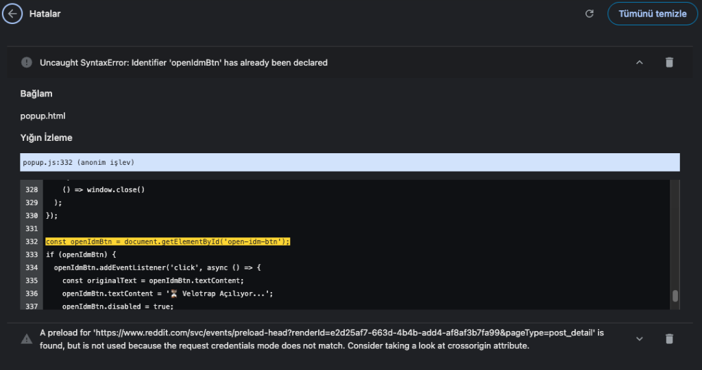
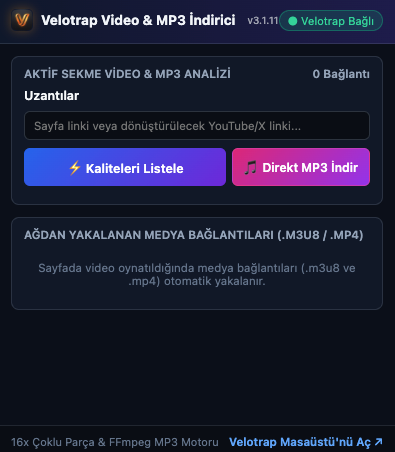
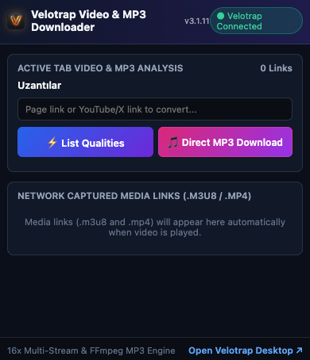
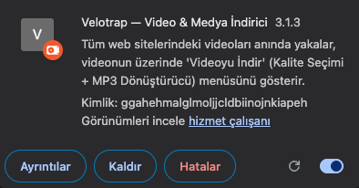

<div align="center">

  

  # ⚡ Velotrap

  **Yeni Nesil Çok Kanallı İndirme Hızlandırıcısı & Evrensel Medya Yakalayıcı**

  [](https://github.com/velotrap/velotrap/releases)
  [](https://opensource.org/licenses/MIT)
  [](https://github.com/velotrap/velotrap)
  [](https://www.electronjs.org/)
  [](https://react.dev/)
  [](https://www.typescriptlang.org/)

  <p align="center">
    <a href="#temel-özellikler">Temel Özellikler</a> •
    <a href="#hızlı-başlangıç">Hızlı Başlangıç</a> •
    <a href="#chrome-eklenti-kurulumu">Chrome Eklentisi</a> •
    <a href="#ekran-görüntüleri">Ekran Görüntüleri</a> •
    <a href="#mimari">Mimari</a> •
    <a href="#kaynak-koddan-derleme">Kaynak Koddan Derleme</a> •
    <a href="README.md">English Documentation 🇬🇧</a>
  </p>

</div>

---

## 🚀 Genel Bakış

**Velotrap**, Internet Download Manager (IDM) gibi eski nesil ve tescilli indirme programlarının yerine modern, yüksek performanslı ve açık kaynaklı bir alternatif olarak geliştirilmiştir.

**Electron**, **TypeScript** ve **React** mimarisiyle inşa edilen Velotrap, dosya indirmelerini **16 eşzamanlı paralel kanala** bölerek internet bant genişliğinizi sonuna kadar kullanır. Kusursuz entegre çalışan **Chrome Eklentisi (Manifest V3)** sayesinde, girdiğiniz tüm web sitelerindeki video akışlarını (`.m3u8`, `.mp4`, `.webm`, `.ts`) otomatik olarak algılar; video üzerinde tek tıkla indirme ve stüdyo kalitesinde 320kbps MP3 ses dönüştürme menüsü sunar.

---

## ✨ Temel Özellikler

| Özellik | Açıklama |
| :--- | :--- |
| ⚡ **16x Çok Kanallı Hızlandırma** | Dosyaları dinamik byte aralıklarına böler ve birbirinden bağımsız TCP soketleri üzerinden paralel indirir. |
| 🎬 **Evrensel Video Yakalayıcı** | Web oynatıcılarındaki HLS (`.m3u8`) oynatma listelerini ve parçalı video akışlarını gerçek zamanlı yakalar. |
| 🎵 **Tek Tıkla 320kbps MP3 Dönüştürücü** | Yakalanan videoları FFmpeg altyapısıyla anında 320 kbps stüdyo kalitesinde MP3 veya kayıpsız WAV formatına çevirir. |
| 🧩 **Manifest V3 Chrome Eklentisi** | Video üzerinde gezinen şık indirme düğmesi, sekme analiz penceresi ve kalite seçim menüsü sunar. |
| 🌐 **Çift Dilli (Türkçe & İngilizce)** | Hem masaüstü uygulaması hem de tarayıcı eklentisi arasında anlık senkronize olan çift dil desteği (`tr` ve `en`). |
| 🎨 **Modern Karanlık Arayüz** | Tailwind CSS ve Lucide ikonlarıyla tasarlanmış, anlık hız grafiği ve kategori filtreleri içeren cam efektli arayüz. |
| 📋 **Akıllı Pano İzleyici** | Kopyalanan medya ve dosya bağlantılarını otomatik tanıyarak indirme penceresini hazır açar. |
| 🛡️ **%100 Gizlilik & Açık Kaynak** | Reklam içermez, veri toplamaz, telemetri barındırmaz. Tamamen kendi bilgisayarınızda yerel çalışır. |

---

## 📸 Ekran Görüntüleri

<div align="center">

### 🖥️ Masaüstü Uygulaması Paneli


<br/><br/>

### 🧩 Chrome Eklentisi & Video Üstü İndirme Menüsü
<table width="100%">
  <tr>
    <td width="33%" align="center">
      <b>Chrome Eklentisi (Türkçe)</b><br/><br/>
      
    </td>
    <td width="33%" align="center">
      <b>Chrome Eklentisi (İngilizce)</b><br/><br/>
      
    </td>
    <td width="33%" align="center">
      <b>Video Üstü İndirme Çubuğu</b><br/><br/>
      
    </td>
  </tr>
</table>

</div>

---

## ⚡ Hızlı Başlangıç (macOS)

### 1. Hazır Kurulum Paketini İndirin
En güncel macOS disk imajını (`.dmg`) [GitHub Sürümler](https://github.com/velotrap/velotrap/releases) sayfamızdan indirin:

* **Apple Silicon & Intel DMG**: `Velotrap_3.1.11.dmg`

İndirdiğiniz `.dmg` dosyasını açın ve **Velotrap** uygulamasını **Uygulamalar (Applications)** klasörüne sürükleyin.

---

## 🧩 Chrome Eklenti Kurulumu

Web sitelerinde videoların otomatik yakalanması ve tek tıkla indirme için:

1. **Velotrap** masaüstü uygulamasını başlatın.
2. **Google Chrome** (veya Chromium tabanlı Brave, Edge, Arc, Opera) tarayıcınızı açın.
3. Adres çubuğuna şunu yazıp Enter'a basın:
   ```text
   chrome://extensions/
   ```
4. Sağ üstteki **Geliştirici modu** (Developer mode) anahtarını açın.
5. Sol üstteki **Paketlenmemiş öge yükle** (Load unpacked) butonuna tıklayın.
6. Velotrap klasöründeki `browser-extension` klasörünü seçin.
7. Eklenti simgesi araç çubuğunuza eklenecek ve yeşil durum göstergesi yanacaktır: **● Velotrap Bağlı**.

---

## 🛠️ Kaynak Koddan Derleme

### Gereksinimler
* **Node.js**: v18.0.0+ (veya [Bun](https://bun.sh) v1.0+)
* **npm** veya **bun**
* **Git**
* **FFmpeg** (Medya dönüştürme ve birleştirme için önerilir)

### Kurulum Adımları

```bash
# 1. Repoyu klonlayın
git clone https://github.com/velotrap/velotrap.git
cd velotrap

# 2. Bağımlılıkları yükleyin
bun install
# veya: npm install

# 3. Electron backend ve Vite arayüzünü derleyin
bun run build:electron
bun run build:vite

# 4. Uygulamayı çalıştırın
bun start
# veya: npm start
```

### macOS DMG Paketi Oluşturma
Bağımsız `.app` paketi ve Apple `.dmg` yükleyici kalıbı oluşturmak için:

```bash
npm run package:mac
```
Üretilen paket `release/Velotrap.dmg` konumuna kaydedilecektir.

---

## 🧪 Motor Testleri

HTTP byte-range doğrulaması, 8 kanallı eşzamanlı parça indirme bütünlüğü, SHA256 sağlama kontrolü ve HLS oynatma listesi ayrıştırma testlerini çalıştırmak için:

```bash
npm test
# veya: node --test tests/engine.test.mjs
```

---

## 🏛️ Mimari Özeti

Velotrap iki ana katmanın yüksek hızlı yerel HTTP köprüsüyle haberleşmesi esasına dayanır:

```
┌─────────────────────────────────┐      HTTP (127.0.0.1:46890)      ┌─────────────────────────────────┐
│     Google Chrome Eklentisi     │ ◄──────────────────────────────► │   Velotrap Masaüstü Uygulaması  │
│  - Ağ İstekleri Yakalayıcı      │                                  │  - Electron Ana Süreci          │
│  - HTML5 Video Üstü Menü        │                                  │  - 16x Paralel İndirme Motoru   │
│  - Hızlı MP3 & Format Seçimi    │                                  │  - yt-dlp & FFmpeg İşleme Hattı │
└─────────────────────────────────┘                                  │  - React 18 / Tailwind Arayüzü  │
                                                                     └─────────────────────────────────┘
```

Ayrıntılı akış şeması ve teknik detaylar için [docs/ARCHITECTURE.md](docs/ARCHITECTURE.md) dosyasını inceleyebilirsiniz.

---

## 🤝 Katkıda Bulunma

Açık kaynak dünyasından gelecek her türlü katkıya açığız! Katkı kuralları, geliştirme adımları ve çekme isteği (PR) süreçleri için [CONTRIBUTING.md](CONTRIBUTING.md) belgesini okuyabilirsiniz.

---

## 📄 Lisans

Bu proje **MIT Lisansı** ile lisanslanmıştır — detaylar için [LICENSE](LICENSE) dosyasına bakabilirsiniz.

---

<div align="center">
  <sub>Velotrap Açık Kaynak Topluluğu tarafından ❤️ ile geliştirildi.</sub>
</div>
