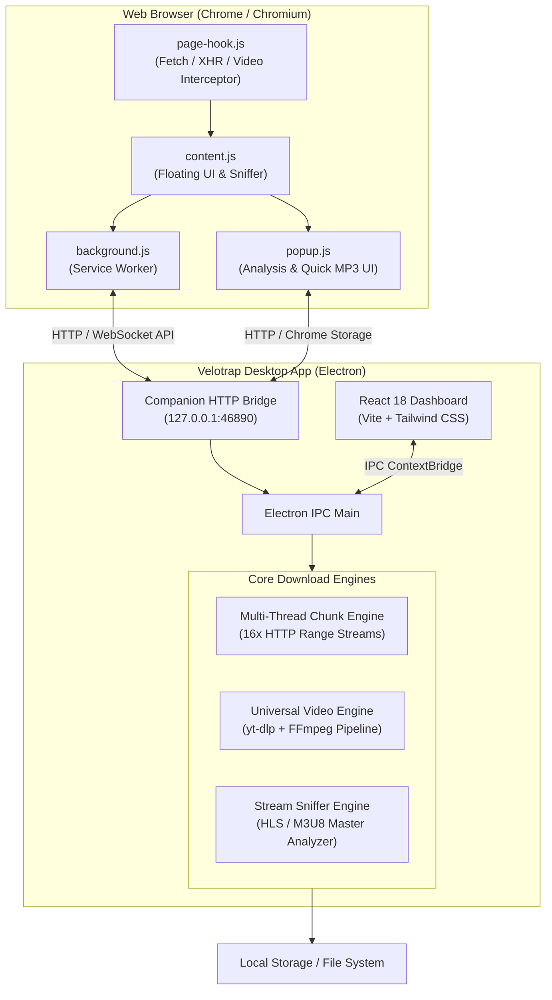

# Velotrap Architecture & Internal Design

This document details the architectural design and internal mechanisms of **Velotrap**, the open-source high-speed multi-threaded download manager and media grabber.

---

## High-Level Architecture Overview

Velotrap is built on a four-tier architecture designed for maximum download throughput, minimal memory overhead, and seamless integration between browser and desktop:

---

## 1. Multi-Threaded Chunk Acceleration Engine (`electron/downloadEngine.ts`)

Velotrap achieves up to 16x accelerated download speeds compared to standard single-stream browser downloads:

1. **HTTP Probe & Range Check**: An initial `HEAD` / `GET` request probes the target server for `Accept-Ranges: bytes` and `Content-Length`.
2. **Dynamic Segment Partitioning**: If the server supports byte ranges, the file size is mathematically divided into up to 16 contiguous byte slices.
3. **Concurrent Stream Workers**: 16 asynchronous worker streams download their corresponding segments in parallel over separate TCP sockets.
4. **Resumable Temporary Storage**: Chunks are written directly into a managed cache directory (`~/.velotrap/temp/`) with checksum tracking.
5. **Zero-Loss Sequential Concatenation**: Once all segments finish downloading, they are merged sequentially into the target destination file without data loss.

---

## 2. Universal Video & MP3 Engine (`electron/videoEngine.ts`)

When downloading media from video sharing platforms, social networks, or protected streams:

- **HLS (.m3u8) Streams**: Segments (`.ts`) are detected by `snifferEngine.ts`, parsed from master playlists, fetched concurrently, and losslessly stitched using FFmpeg.
- **Audio Extraction**: If the user selects "Direct MP3" or audio format presets (320kbps Studio, 192kbps Standard, WAV Lossless, M4A), audio streams are extracted and encoded with FFmpeg in a single pass.
- **Self-Contained Binaries**: Velotrap automatically manages platform-specific binaries for `yt-dlp` and `ffmpeg` in the user's application support directory.

---

## 3. Chrome Manifest V3 Companion Extension (`browser-extension/`)

The extension communicates with the desktop application through a local HTTP companion bridge on `http://127.0.0.1:46890`:

- **`page-hook.js`**: Injected at `document_start` into the page's `MAIN` execution world to intercept XHR, `window.fetch`, and HTML5 `<video>` source attributes before playback starts.
- **`content.js`**: Injected in the `ISOLATED` world; binds to HTML `<video>` elements to render a sleek, non-intrusive floating download pill ("Videoyu İndir" / "Download Video") with quality picker and 1-click MP3.
- **`popup.js`**: Quick action popup displaying active tab stream analysis, manual URL input, instant format selection, and connection health status.
- **Language Synchronization**: Listens to changes in the desktop app's language settings and immediately mirrors English or Turkish localization in the extension.

---

## 4. Security & Privacy Guarantees

- **No Remote Telemetry**: Velotrap does not transmit your downloads, browsing history, or personal data to any external server.
- **Local Bridge Only**: The companion HTTP server is strictly bound to `127.0.0.1` (loopback interface) and rejects non-local network requests.
- **Sandboxed IPC**: The renderer UI interacts with the native backend exclusively through an explicit Electron `contextBridge` (`electron/preload.ts`), with Node integration disabled in the renderer window.
